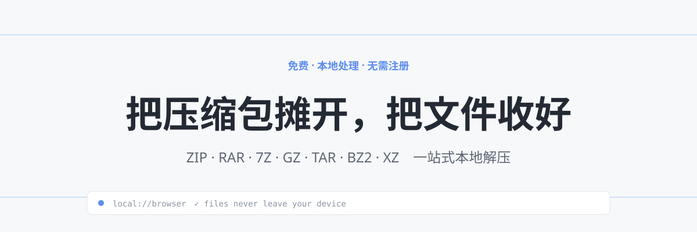
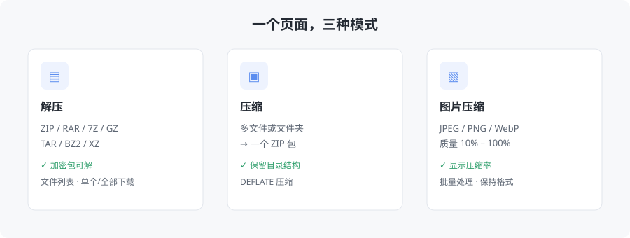

<p align="center">
  <b>简体中文</b>
</p>

<p align="center">
  <picture>
    <source media="(prefers-color-scheme: dark)" srcset="docs/assets/hero-dark.svg">
    
  </picture>
</p>

<p align="center">
  一个纯前端、本地优先的在线解压缩工具：解压、压缩、压图片，一个页面搞定。<br>文件永不离开浏览器。
</p>

<p align="center">
  <a href="https://github.com/arsnyeon/online-unzip-tool"></a>
  <a href="https://yasuo.zip/"></a>
  <a href="https://github.com/arsnyeon/online-unzip-tool/issues"></a>
  <a href="https://github.com/arsnyeon/online-unzip-tool/stargazers"></a>
</p>

<br>

<h3 align="center">一个页面，三种模式</h3>

<p align="center">
  
</p>

<br>

<h3 align="center">解压：常见格式走快通道，冷门格式按需加载引擎</h3>

<p align="center">
  ZIP 用 JSZip、GZ 用 pako、TAR 自研解析，打开即用；RAR / 7Z / BZ2 / XZ / 加密压缩包由 WASM 引擎按需加载，不拖慢首屏。
</p>

<p align="center">
  <code>ZIP</code> <code>RAR4/RAR5</code> <code>7Z</code> <code>GZ</code> <code>TAR</code> <code>BZ2</code> <code>XZ</code> <code>tar.gz / tar.bz2 / tar.xz</code>
</p>

<br>

<h3 align="center">本地处理，不是口号</h3>

<p align="center">
  所有解压、压缩与图片处理都在你的浏览器里完成。没有上传接口，没有文件中转。文件名用 DOM API 渲染，避免恶意文件名注入。
</p>

<br>

<h3 align="center">看起来也舒服</h3>

<p align="center">
  Gentle Mist Blue 视觉：雾蓝只用于品牌、焦点与高亮，正文保持中性灰。跟随系统深浅色，也可手动切换；桌面与手机都好用。
</p>

<br>

## 可以做什么

- **解压**支持 ZIP、RAR、7Z、TAR、GZ、BZ2 和 XZ，也识别 `.tar.gz` / `.tgz`、`.tar.bz2` / `.tbz2`、`.tar.xz` / `.txz`。加密包请先填写密码，兼容性取决于具体的加密方式。
- **打包**输出 ZIP，保留所选文件及其目录。默认使用标准压缩，照片、视频等已经压缩的数据可以选择「仅打包，不压缩」。
- **图片压缩**：按质量或目标大小处理 JPEG、PNG、WebP。PNG 不使用有损质量参数；输出没有变小时保留原图。只有明确允许才会缩小尺寸，目标大小不保证一定能达到。
- **按需下载**：在结果中输入文件名或路径（例如 `docs/`），勾选需要的条目后下载，也可以保存全部。
- **本地处理**：文件不上传。解压时单包最多 500 MB；打包或处理图片时，整批输入合计最多 500 MB。首次使用部分格式需要联网加载处理组件。

## 快速开始

可以直接访问线上站点：[https://yasuo.zip/](https://yasuo.zip/)。

### 本地开发与构建

使用 Node.js 22.12+（或 20.19+）及 npm，在仓库根目录运行：

```bash
npm ci
npm run dev
```

打开终端显示的本地地址。首页右侧的终端窗口就是文件工作区；手机上位于介绍下方。选择模式、处理文件、筛选和下载结果都在同一页完成。分享时可使用 `/?mode=extract#workspace`、`/?mode=compress#workspace` 或 `/?mode=image-compress#workspace` 直达相应模式。

```bash
npm run build    # 输出到 dist/
npm run preview  # 通过本地 HTTP 预览生产构建
```

### 静态部署

部署整个 **`dist/` 目录的内容**，不要直接发布源码目录。首页是唯一入口，构建保留同源 Worker、相对资源 URL 以及 `CNAME`（`yasuo.zip`）。GitHub Pages 可在 Settings → Pages 中选择 **GitHub Actions**，使用仓库中的 `.github/workflows/pages.yml` 工作流；其他静态平台将构建命令设为 `npm run build`，发布目录设为 `dist`。自定义域名仍需在托管平台绑定并配置 DNS。

## 技术栈

- Vue 3 + Vite：项目首页与静态构建。
- 首页直接挂载工作区，使用浏览器文件 API 和 Canvas，无需后端或 iframe。
- JSZip 处理 ZIP；pako 处理 GZ；TAR 原生解析。
- libarchive.js（WASM，经 jsDelivr CDN 加载）处理 RAR / 7Z / BZ2 / XZ 和加密包。Worker 通过同源入口启动。

## 目录

| 路径 | 内容 |
| --- | --- |
| `index.html`、`src/` | Vue 首页入口与组件 |
| `src/InlineWorkspace.vue` | 首页内的文件处理工作区 |
| `vite.config.js` | 构建首页并收集静态资源 |
| `src/home.css` | 首页布局、主题与响应式样式 |
| `js/script.js` | 全部功能逻辑与 JSDoc 注释 |
| `js/libarchive-worker-shim.js` | 多格式引擎的同源 Worker 代理 |
| `docs/assets/` | README 使用的自制 SVG 示意图 |
| `favicon.ico`、`logo.png` | 站点图标 |
| `CNAME`、`robots.txt`、`sitemap.xml` | 站点部署与 SEO 配置 |
| `LICENSE` | MIT 许可证 |
| `DESIGN.md` | 界面设计契约 |
| `CHANGELOG.md` | 版本更新记录 |
| `README.md` | 项目说明 |

## 常见问题

<details>
<summary><b>和 DeepSeek 官方有关系吗？</b></summary>
<br>
没有关系。这是 ArsnYeon 的个人开源项目，与 DeepSeek 无关。
</details>

<details>
<summary><b>文件会上传到服务器吗？</b></summary>
<br>
不会。所有处理在浏览器本地完成。页面会从 CDN 加载 JSZip、pako 和 libarchive.js 等代码库，但你的文件本身不会上传。
</details>

<details>
<summary><b>为什么 rar / 7z 第一次解压慢一点？</b></summary>
<br>
这些格式由 WASM 引擎处理，第一次使用时才从 CDN 下载引擎文件（约 1MB）。之后浏览器缓存会加快速度。
</details>

<details>
<summary><b>支持 RAR5 和加密包吗？</b></summary>
<br>
支持。解压模式下填写密码即可尝试解压加密的 RAR / 7Z 压缩包。密码只在本地传给解压引擎。
</details>

<details>
<summary><b>为什么单个文件限制 500MB？</b></summary>
<br>
浏览器端解压需要在内存中处理文件，500MB 是兼顾可用性和稳定性的限制。更大的文件建议使用桌面软件。
</details>

<details>
<summary><b>开源吗？</b></summary>
<br>
开源，代码以 MIT 许可证发布，详见 <a href="LICENSE">LICENSE</a>。
</details>

## 参与贡献

问题反馈与改进建议欢迎提交到 [Issues](https://github.com/arsnyeon/online-unzip-tool/issues)，也欢迎 Pull Request。

## 许可证与致谢

本项目采用 [MIT 许可证](LICENSE)。

第三方库：

- [JSZip](https://github.com/Stuk/jszip) — ZIP 处理
- [pako](https://github.com/nodeca/pako) — GZIP 处理
- [libarchive.js](https://github.com/nika-begiashvili/libarchivejs) — 多格式 WASM 解压引擎

<p align="center"><sub>yasuo.zip 是个人开源项目，与文中提到的其他项目无关联。</sub></p>
